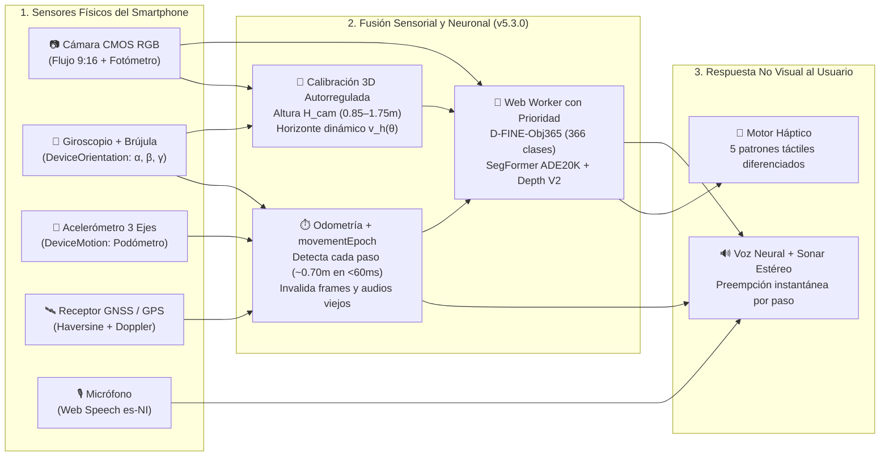

# Sensores del Smartphone y Requisitos Mínimos de Hardware — AVISIA v5.3.0
**Proyecto de Trabajo Final — Universidad Americana (UAM Managua)**  
*Asistencia Visual Inteligente para Movilidad Peatonal de Personas con Discapacidad Visual*

---

## 1. Arquitectura Multisensorial del Smartphone en AVISIA (`v5.3.0`)

AVISIA transforma un teléfono inteligente convencional en un **sistema de percepción espacial y odometría peatonal en tiempo real**, fusionando **8 subsistemas de sensores y actuadores** del dispositivo para eliminar puntos ciegos, autocalibrar la geometría 3D de la cámara y descartar notificaciones atrasadas cuando el usuario avanza paso a paso.



---

### Tabla Detallada de Sensores y Actuadores Utilizados

| # | Sensor / Subsistema Físico | API / Permiso en Android & Web | Parámetros Físicos Medidos | Función Específica dentro de AVISIA `v5.3.0` | Módulo del Código Fuente |
| :-: | :--- | :--- | :--- | :--- | :--- |
| **1** | **Cámara Trasera CMOS RGB** | `MediaDevices.getUserMedia`<br>`android.permission.CAMERA` | • Cuadros RGB (`720×1280` / `640×480`, 9:16)<br>• Luminancia media ($Y \in [0..255]$)<br>• Flujo óptico ($\Delta Y$ entre cuadros) | • **Inferencia neuronal**: `D-FINE-Obj365` (366 clases), `SegFormer ADE20K` (puertas, cortinas, paredes, piso libre) y `Depth Anything V2`.<br>• **Fotómetro**: Mide el `%` de luz ambiental y detecta si el lente está tapado (`lens_blocked`).<br>• **Lector OCR y Billetes**: Identifica Córdobas (`C$10–C$1000`) y Dólares (`\$1–\$100`). | `src/services/CameraService.ts`<br>`src/services/DetectorService.ts`<br>`src/services/DepthProximityService.ts` |
| **2** | **Giroscopio 3D + Magnetómetro (IMU de Orientación)** | `DeviceOrientationEvent`<br>(Sensores de fusión de actitud Android) | • **`beta` ($\beta$)**: Inclinación vertical (`-180°..180°`)<br>• **`gamma` ($\gamma$)**: Alabeo lateral (`-90°..90°`)<br>• **`alpha` ($\alpha$)**: Rumbo magnético/giroscópico (`0°..360°`) | • **Inclinación ($\theta_{\text{down}} = 90^\circ - \beta$)**: Calcula el horizonte dinámico $v_h(\theta)$ y corrige trigonométricamente la distancia a objetos en el suelo.<br>• **Postura**: Detecta si el celular va **Vertical**, **Horizontal** o **Diagonal** ($\|\gamma\| \ge 34^\circ$).<br>• **Dirección**: Confirma si apunta **Al frente** o si giró ($\Delta\alpha \ge 20^\circ$), invalidando alertas previas. | `src/services/CameraCalibrationService.ts`<br>`src/services/PedestrianNavigationService.ts` |
| **3** | **Acelerómetro MEMS de 3 Ejes (Podómetro Inercial)** | `DeviceMotionEvent`<br>(`acceleration` y `accelerationIncludingGravity`) | • Vector de aceleración $(a_x, a_y, a_z)$ en $\text{m/s}^2$<br>• Magnitud dinámica sobre gravedad ($\|a\| - g \ge 1.25\text{ m/s}^2$) | • **Detección de pasos en `< 60 ms`**: Detecta cada paso físico ($\approx 0.70\text{ m}$) incluso en interiores donde el GPS no tiene resolución de 1 paso.<br>• **Limpieza de cola de voz**: Al dar un paso incrementa `movementEpoch`, descarta inferencias viejas del Web Worker e interrumpe audios de la posición anterior. | `src/services/PedestrianNavigationService.ts`<br>`src/App.tsx` |
| **4** | **Receptor GNSS / GPS de Alta Precisión** | `Geolocation.watchPosition` (`enableHighAccuracy: true`)<br>`ACCESS_FINE_LOCATION` | • Latitud y Longitud (`WGS84`)<br>• Velocidad Doppler ($v_{\text{GPS}}$ en $\text{m/s}$)<br>• Radio de precisión horizontal ($\pm\text{m}$) | • **Odometría exterior**: Calcula el desplazamiento real mediante fórmula geodésica de **Haversine** ($\Delta d_{\text{GPS}}$) para refrescar avisos al caminar en aceras.<br>• **Ubicación en Managua**: Geocodificación inversa de calles, barrios y paradas de autobús. | `src/services/PedestrianNavigationService.ts`<br>`src/services/LocationService.ts` |
| **5** | **Micrófono con Cancelación de Ruido** | `SpeechRecognition` / `webkitSpeechRecognition`<br>`RECORD_AUDIO` | • Voz en español (`es-NI` / `es-419`)<br>• Detección continua de palabra de activación (*Wake Word*) | • **Interacción manos libres**: Escucha el comando *«Oye Avisia»* y preguntas naturales (*«¿Qué hay frente a mí?»*, *«¿De cuánto es este billete?»*, *«¿Está despejado?»*). | `src/services/SpeechService.ts`<br>`src/services/ConversationService.ts` |
| **6** | **Actuador Háptico (Motor de Vibración)** | `Navigator.vibrate()`<br>`android.permission.VIBRATE` | • 5 secuencias temporales de pulsos táctiles en milisegundos (`ms`) | • **Comunicación táctil silenciosa**:<br>  - `danger` (`[120,55,120,55,180] ms`): Pared/peligro cercano.<br>  - `step` (`[220,80,120] ms`): Grada o escalera 3D.<br>  - `caution` (`[70] ms`): Precaución / corregir ángulo.<br>  - `blocked` (`[300] ms`): Cámara tapada o sin luz.<br>  - `confirm` (`[45] ms`): Acción o billete confirmado. | `src/services/SpeechService.ts` |
| **7** | **Sintetizador de Voz, Audio Estéreo y Bluetooth** | `Capacitor TextToSpeech` + `Web Audio API (StereoPanner)` + `MediaSession API` | • Paneo espacial izquierdo/derecho (`-1.0 .. +1.0`)<br>• Frecuencia acústica (`220 Hz .. 880 Hz`)<br>• Eventos de botón Bluetooth (`play/pause`) | • **Sonar Estéreo 3D**: Emite pulsos hacia el oído izquierdo (`a las 10`), centro (`a las 12`) o derecho (`a las 2`).<br>• **Botón Bluetooth**: Permite consultar a AVISIA presionando el botón del audífono sin sacar el celular. | `src/services/SpeechService.ts`<br>`src/App.tsx` |
| **8** | **Control de Pantalla Activa y Red** | `Screen Wake Lock API` + `Navigator.onLine` | • Estado de bloqueo de pantalla<br>• Estado de conectividad (`Online / Offline`) | • **Seguridad continua**: Impide que la pantalla y la cámara se apaguen mientras la persona usuaria camina.<br>• **Resiliencia Offline**: Conmuta sin interrupción a motores 100% locales cuando no hay internet. | `src/components/LiveCameraPanel.tsx`<br>`src/App.tsx` |

---

## 2. Requisitos Mínimos y Recomendados del Smartphone

AVISIA ha sido optimizado mediante **cuantización entera de 8 bits (`INT8 / q8`)**, **ejecución asíncrona en Web Worker con planificador de prioridad** y **arranque instantáneo híbrido (MediaPipe GPU + ONNX WebAssembly SIMD)** para funcionar en teléfonos Android accesibles en Nicaragua, sin requerir hardware de gama alta ni servidores GPU externos.

### Matriz de Requisitos de Hardware y Software del Dispositivo

| Especificación | Requisito Mínimo Funcional (Gama de Entrada) | Requisito Recomendado (Gama Media — Uso Diario Fluido) | Configuración Óptima / Investigación (Gama Media-Alta) |
| :--- | :--- | :--- | :--- |
| **Sistema Operativo** | **Android 7.0 Nougat (`API Level 24`)** o superior<br>*(iOS 15.4+ en versión Web PWA)* | **Android 11 a Android 15 (`API Level 30–36`)** | **Android 13 a Android 15 (`API Level 33–36`)** |
| **Procesador (SoC / CPU)** | **ARM64 (`arm64-v8a`) Octa-Core $\ge 1.8\text{ GHz}$**<br>*(Ej. Snapdragon 665/680, Helio G85, Exynos 850)* | **ARM64 Octa-Core $\ge 2.2\text{ GHz}$**<br>*(Ej. Snapdragon 695 / 7s Gen 2, Dimensity 7050, Exynos 1380)* | **ARM64 Octa-Core $\ge 2.8\text{ GHz}$ con NPU/GPU avanzada**<br>*(Ej. Snapdragon serie 8, Dimensity 8300/9200, Google Tensor)* |
| **Memoria RAM** | **3 GB de RAM** *(mínimo estricto)* | **4 GB a 6 GB de RAM** | **8 GB o más de RAM** |
| **GPU y Motor de Inferencia** | **WebGL 2.0 + WebAssembly SIMD**<br>*(Android System WebView / Chrome $\ge$ v108)* | **WebGPU + WebAssembly SIMD Multihilo**<br>*(Chrome / WebView $\ge$ v121)* | **WebGPU dedicado FP16 / INT8**<br>*(Permite activar VLM Offline `SmolVLM-256M` local)* |
| **Cámara Trasera** | **8 MP** (`720p @ 30 fps`) con autoenfoque | **12 MP+** (`1080p @ 30 fps`) con autoenfoque rápido y HDR | **12 MP–50 MP** con estabilización óptica/electrónica (OIS/EIS) |
| **Almacenamiento Libre** | **150 MB libres**<br>*(APK ~35 MB + Caché IndexedDB de modelos ~85 MB)* | **300 MB libres** | **1 GB libre** *(si se descarga el VLM Offline completo)* |
| **Sensores Indispensables** | Cámara trasera, Acelerómetro 3 ejes, Giroscopio/Orientación, Vibrador, Micrófono y Altavoz | + Receptor **GPS/GLONASS** de alta precisión y **Bluetooth 5.0+** (para audífonos de conducción ósea) | + Brújula magnetométrica calibrada y audífonos Bluetooth manos libres |
| **Conectividad** | **Opcional (Funciona 100% Offline)** tras la primera descarga de pesos; 3G/4G/Wi-Fi solo para geocodificación y consultas VLM en nube | **4G LTE / Wi-Fi** para consultas de escena con IA en la nube y nombres de calles en Managua | **4G/5G / Wi-Fi** + respaldo VLM Offline local |
| **Rendimiento Esperado en AVISIA** | • Modo `Calle y Exterior` / `EfficientDet`: **~8–12 FPS**<br>• Modo `Interiores` (`D-FINE` + `SegFormer-B0`): **~2–3 FPS** | • Fusión completa `D-FINE-Obj365` (366 clases) + `SegFormer-B0` + Calibración 3D + Odometría: **~5 FPS (ciclo de 180–210 ms)** | • Fusión completa + `SegFormer-B1` + `Depth Anything V2` + `SmolVLM`: **Tiempo real (<150 ms)** |

---

### Presupuesto de Memoria y Peso de los Modelos Neuronales en el Celular

Para justificar técnicamente por qué **3 GB – 4 GB de RAM** y **150 MB de almacenamiento** son suficientes:

| Modelo Neuronal en AVISIA `v5.3.0` | Tarea Espacial | Cuantización | Tamaño en Caché Local | Consumo de RAM en Ejecución |
| :--- | :--- | :---: | :---: | :---: |
| **EfficientDet-Lite0 / Lite2** *(MediaPipe GPU)* | Arranque instantáneo (<1 s) y seguimiento rápido | `Float16 / INT8` | `4.4 MB – 7.2 MB` | `~45 MB` |
| **D-FINE-Small Objects365** *(ONNX Worker)* | Detección de **366 clases** interiores y urbanas (escritorio, pizarra, silla, extintor, persona) | `INT8 (q8)` | `~19.8 MB` | `~140 MB` |
| **SegFormer-B0 ADE20K** *(ONNX Worker)* | Segmentación semántica de **puertas, cortinas, paredes y piso caminable** (Stixels 5 sectores) | `INT8 (q8)` | `~4.1 MB` | `~95 MB` |
| **Depth Anything V2 Small** *(ONNX Worker)* | Mapa de profundidad 3D ($1/Z$), gradas reales y estado de puertas (abierta/cerrada) | `INT8 (q8)` | `~25.4 MB` | `~165 MB` |
| **Calibración 3D + Odometría GPS/IMU** | Altura del piso ($H_{\text{cam}}$), inclinación ($\theta$), rumbo y podómetro de pasos (`movementEpoch`) | Algorítmico Nativos (`Float32`) | `< 0.05 MB` | `< 5 MB` |
| **Total del Pipeline Local en Vivo** | **Navegación Asistiva Completa sin Costo de Nube** | **Híbrido `q8` / `FP16`** | **`~56 MB` en caché** | **`~450 MB` de RAM total** |

---

## 3. Fragmento HTML Listo para Insertar en tu Presentación

Puedes copiar y pegar el siguiente bloque `<section>` directamente dentro del archivo HTML de tu presentación (usa estilos CSS integrados compatibles con cualquier plantilla de diapositivas o Tailwind):

```html
<!-- DIAPOSITIVA: SENSORES DEL SMARTPHONE Y REQUISITOS MÍNIMOS (AVISIA v5.3.0 - UAM MANAGUA) -->
<section style="background:#0a0e16; color:#dfe2ee; font-family:'Inter',system-ui,sans-serif; padding:32px; border-radius:24px; border:1px solid rgba(138,235,255,0.25); max-width:1280px; margin:0 auto;">
  <div style="display:flex; align-items:center; justify-content:space-between; flex-wrap:wrap; gap:12px; border-bottom:1px solid rgba(138,235,255,0.2); padding-bottom:16px; margin-bottom:24px;">
    <div>
      <span style="background:rgba(34,211,238,0.15); color:#8aebff; border:1px solid rgba(138,235,255,0.35); padding:4px 12px; border-radius:999px; font-size:12px; font-weight:700; letter-spacing:0.05em;">
        ARQUITECTURA FÍSICA Y HARDWARE · AVISIA v5.3.0
      </span>
      <h2 style="font-size:26px; font-weight:800; color:#ffffff; margin:10px 0 4px 0;">
        Fusión de Sensores del Smartphone y Requisitos del Dispositivo
      </h2>
      <p style="font-size:14px; color:#bbc9cd; margin:0;">
        Calibración 3D autorregulada, odometría peatonal paso a paso (&lt;60 ms) e inferencia neuronal local cuantizada (INT8)
      </p>
    </div>
    <div style="text-align:right; font-family:monospace; font-size:12px; color:#4edea3;">
      <div>✓ ~56 MB Peso Total Modelos</div>
      <div>✓ ~450 MB Consumo RAM</div>
      <div>✓ 100% Operativo Offline</div>
    </div>
  </div>

  <!-- GRID 2 COLUMNAS: SENSORES (IZQUIERDA) + REQUISITOS MÍNIMOS (DERECHA) -->
  <div style="display:grid; grid-template-columns:repeat(auto-fit, minmax(480px, 1fr)); gap:24px;">
    
    <!-- COLUMNA 1: SENSORES DEL CELULAR -->
    <div style="background:#141821; border:1px solid rgba(60,73,76,0.5); border-radius:18px; padding:20px;">
      <h3 style="font-size:16px; font-weight:800; color:#8aebff; margin:0 0 14px 0; text-transform:uppercase; letter-spacing:0.04em;">
        1. Sensores del Celular Utilizados en Tiempo Real
      </h3>

      <div style="display:flex; flex-direction:column; gap:10px; font-size:13px;">
        <div style="background:#1c2028; padding:11px 14px; border-radius:12px; border-left:4px solid #22d3ee;">
          <strong style="color:#ffffff;">📷 Cámara CMOS RGB + Fotómetro Ambiental</strong>
          <div style="color:#bbc9cd; margin-top:3px;">
            Captura video 9:16 para <code>D-FINE-Obj365</code> (366 clases), <code>SegFormer ADE20K</code> (puertas, cortinas, paredes, piso libre) y <code>Depth V2</code>. Mide luz ambiental (0–100%), bloqueo de lente y lee billetes (C$ y US$).
          </div>
        </div>

        <div style="background:#1c2028; padding:11px 14px; border-radius:12px; border-left:4px solid #4edea3;">
          <strong style="color:#ffffff;">🧭 Giroscopio 3D + Brújula (DeviceOrientation: α, β, γ)</strong>
          <div style="color:#bbc9cd; margin-top:3px;">
            <strong>Autocalibración 3D:</strong> Mide inclinación vertical (<em>pitch</em> β), postura vertical/horizontal (<em>roll</em> γ) y rumbo frontal (<em>yaw</em> α). Calcula la altura sobre el piso (0.85–1.75 m) y el horizonte dinámico.
          </div>
        </div>

        <div style="background:#1c2028; padding:11px 14px; border-radius:12px; border-left:4px solid #fbbf24;">
          <strong style="color:#ffffff;">🦶 Acelerómetro MEMS 3 Ejes (Podómetro Inercial &lt;60 ms)</strong>
          <div style="color:#bbc9cd; margin-top:3px;">
            Detecta el pico dinámico de cada paso físico (~0.70 m) dentro y fuera de edificios. Al dar un paso, incrementa <code>movementEpoch</code> y <strong>cancela audios e inferencias atrasadas de la posición anterior</strong>.
          </div>
        </div>

        <div style="background:#1c2028; padding:11px 14px; border-radius:12px; border-left:4px solid #c084fc;">
          <strong style="color:#ffffff;">🛰️ Receptor GPS de Alta Precisión (Haversine + Doppler)</strong>
          <div style="color:#bbc9cd; margin-top:3px;">
            Mide desplazamiento geodésico real y velocidad de marcha en exteriores, además de geocodificar calles, barrios y paradas de autobús en Managua.
          </div>
        </div>

        <div style="background:#1c2028; padding:11px 14px; border-radius:12px; border-left:4px solid #fb7185;">
          <strong style="color:#ffffff;">📳 Motor Háptico + 🎙️ Micrófono + 🎧 Audio Estéreo / BT</strong>
          <div style="color:#bbc9cd; margin-top:3px;">
            5 patrones táctiles de vibración (pared, grada, precaución, lente tapado, confirmación), comando de voz manos libres (<em>«Oye Avisia»</em>) y sonar estéreo izquierdo/centro/derecho.
          </div>
        </div>
      </div>
    </div>

    <!-- COLUMNA 2: REQUISITOS MÍNIMOS Y RECOMENDADOS -->
    <div style="background:#141821; border:1px solid rgba(60,73,76,0.5); border-radius:18px; padding:20px; display:flex; flex-direction:column; justify-content:space-between;">
      <div>
        <h3 style="font-size:16px; font-weight:800; color:#4edea3; margin:0 0 14px 0; text-transform:uppercase; letter-spacing:0.04em;">
          2. Requisitos del Smartphone (Android / Web PWA)
        </h3>

        <table style="width:100%; border-collapse:collapse; font-size:12.5px;">
          <thead>
            <tr style="background:#0a0e16; color:#8aebff; text-align:left; border-bottom:1px solid rgba(138,235,255,0.25);">
              <th style="padding:9px 10px;">Componente</th>
              <th style="padding:9px 10px;">Mínimo Funcional</th>
              <th style="padding:9px 10px; color:#4edea3;">Recomendado (Fluido ~5 FPS)</th>
            </tr>
          </thead>
          <tbody style="divide-y:1px solid rgba(60,73,76,0.3);">
            <tr style="border-bottom:1px solid rgba(60,73,76,0.3);">
              <td style="padding:9px 10px; font-weight:700; color:#ffffff;">Sistema Operativo</td>
              <td style="padding:9px 10px; color:#bbc9cd;">Android 7.0+ (API 24)</td>
              <td style="padding:9px 10px; color:#dfe2ee; font-weight:600;">Android 11 – 15 (API 30–36)</td>
            </tr>
            <tr style="border-bottom:1px solid rgba(60,73,76,0.3);">
              <td style="padding:9px 10px; font-weight:700; color:#ffffff;">Procesador (SoC)</td>
              <td style="padding:9px 10px; color:#bbc9cd;">ARM64 8 núcleos ≥ 1.8 GHz<br><span style="font-size:11px;">(Snapdragon 665 / Helio G85)</span></td>
              <td style="padding:9px 10px; color:#dfe2ee; font-weight:600;">ARM64 8 núcleos ≥ 2.2 GHz<br><span style="font-size:11px; color:#4edea3;">(Snapdragon 695 / 7s Gen 2 / Dimensity 7050)</span></td>
            </tr>
            <tr style="border-bottom:1px solid rgba(60,73,76,0.3);">
              <td style="padding:9px 10px; font-weight:700; color:#ffffff;">Memoria RAM</td>
              <td style="padding:9px 10px; color:#bbc9cd;"><strong>3 GB RAM</strong></td>
              <td style="padding:9px 10px; color:#4edea3; font-weight:700;">4 GB – 6 GB RAM</td>
            </tr>
            <tr style="border-bottom:1px solid rgba(60,73,76,0.3);">
              <td style="padding:9px 10px; font-weight:700; color:#ffffff;">Aceleración IA</td>
              <td style="padding:9px 10px; color:#bbc9cd;">WebGL 2.0 + WASM SIMD<br><span style="font-size:11px;">(Chrome / WebView v108+)</span></td>
              <td style="padding:9px 10px; color:#dfe2ee; font-weight:600;">WebGPU + WASM SIMD Multihilo<br><span style="font-size:11px; color:#8aebff;">(Chrome / WebView v121+)</span></td>
            </tr>
            <tr style="border-bottom:1px solid rgba(60,73,76,0.3);">
              <td style="padding:9px 10px; font-weight:700; color:#ffffff;">Cámara Trasera</td>
              <td style="padding:9px 10px; color:#bbc9cd;">8 MP (720p @ 30 fps) AF</td>
              <td style="padding:9px 10px; color:#dfe2ee; font-weight:600;">12 MP+ (1080p @ 30 fps) AF + HDR</td>
            </tr>
            <tr>
              <td style="padding:9px 10px; font-weight:700; color:#ffffff;">Almacenamiento</td>
              <td style="padding:9px 10px; color:#bbc9cd;">150 MB libres</td>
              <td style="padding:9px 10px; color:#dfe2ee; font-weight:600;">300 MB libres (caché IndexedDB)</td>
            </tr>
          </tbody>
        </table>
      </div>

      <!-- NOTA DE ACCESIBILIDAD ECONÓMICA -->
      <div style="margin-top:14px; background:rgba(78,222,163,0.1); border:1px solid rgba(78,222,163,0.35); border-radius:12px; padding:11px 14px; font-size:12px; color:#dfe2ee;">
        <strong style="color:#4edea3;">Accesibilidad Tecnológica en Nicaragua:</strong>
        Gracias a la cuantización <code>INT8 (q8)</code> y el planificador de prioridad en Web Worker, AVISIA opera en smartphones de gama media-baja (~US$130–$220) sin requerir iPhone Pro, sensores LiDAR dedicados ni suscripciones de pago.
      </div>
    </div>

  </div>
</section>
```
